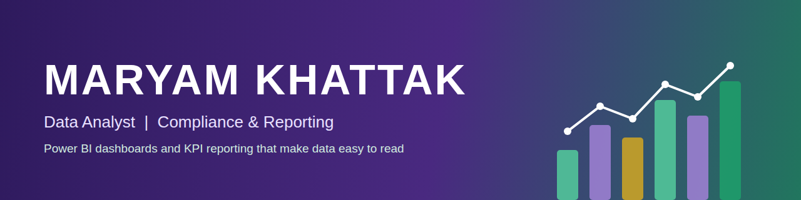
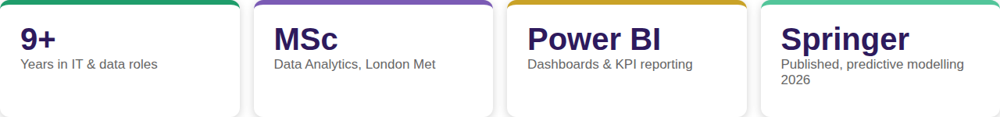

  

  <a href="https://www.linkedin.com/in/maryam-khattak">LinkedIn</a> &nbsp;·&nbsp;
  <a href="https://maryamkhattak.wixsite.com/data-analyst">Portfolio</a> &nbsp;·&nbsp;
  <a href="https://link.springer.com/chapter/10.1007/978-3-032-12830-0_20">Publication</a> &nbsp;·&nbsp;
  <a href="mailto:maryamkhattak@hotmail.com">Email</a>

  

## About me

I'm a data analyst in Reading, UK, with an MSc in Data Analytics from London Metropolitan University. I work with retrofit and energy-efficiency programme data, checking it across systems and turning it into dashboards and KPI reports that people can read at a glance.

Before moving into analytics I spent nine years in IT infrastructure and systems roles, which is why I care about data that is accurate, well documented and ready for audit.

## What I do

**Dashboards and reporting for energy efficiency programmes.** I build Power BI dashboards and KPI reports for UK retrofit and energy-efficiency delivery, covering installation progress, compliance status and installer performance across GLA and local-authority housing programmes. The reporting gives programme managers, delivery teams and funders a clear view of what is on track and where action is needed, backed by short written commentary.

**Data validation.** Reconciling property, installation and compliance data from several systems and flagging gaps early.

**Analysis and modelling.** Forecasting, anomaly detection and predictive models in Python and R.

## Tools

**Reporting:** Power BI, Excel  
**Data:** SQL, Python, R  
**Platforms:** Azure, Microsoft 365, Git

## Projects

- [Currency Pair Analysis & Anomaly Detection](https://github.com/maryam-khattak/Currency-Pair-Analysis-Anomaly-Detection) – Time series analysis and anomaly detection
- [Predictive Analytics for Netflix](https://github.com/maryam-khattak/Predictive-Analytics-for-Netflix) – Predictive modelling
- [Marketing Campaign Predictive Modelling](https://github.com/maryam-khattak/Comprehensive-Data-Analysis-Predictive-Modeling-for-Marketing-Campaigns) – Campaign data analysis and prediction
- [Statistical Modelling and Forecasting](https://github.com/maryam-khattak/Statistical-Modelling-and-Forecasting-Case-Study) – Forecasting case study in R
- [UK Oil and Gas Reserves Analysis](https://github.com/maryam-khattak/UK-Oil-and-Gas-Reserves-and-Resources-Analysis) – Public data analysis
- [Online Retailer Data Warehouse](https://github.com/maryam-khattak/Blue-Sky-Online-Retailer-Data-Warehouse-Implementation) – Data warehouse design in T-SQL

## Let's talk

I'm looking for Data or Reporting Analyst roles. The quickest way to reach me is [LinkedIn](https://www.linkedin.com/in/maryam-khattak) or [email](mailto:maryamkhattak@hotmail.com).
